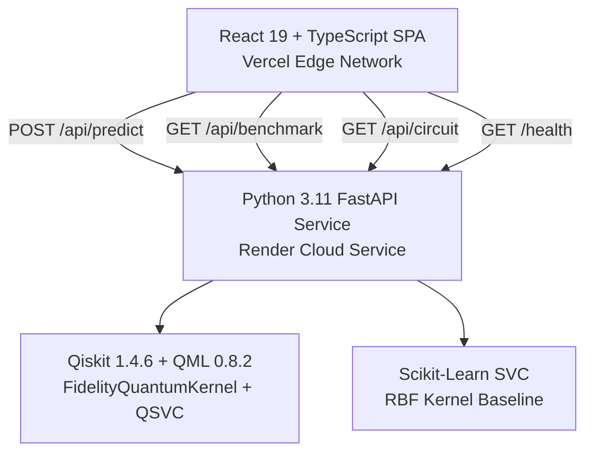

<div align="center">

# Q-Silience — Q-Resilience AI
### Quantum-Enhanced Microgrid Anomaly Detection & Autonomous Protection

**VTU-Qiskit Fall Fest 2026** &nbsp;|&nbsp; Team **Ctrl_AI** (`VTU-QFF-HC-0025`) &nbsp;|&nbsp; Tier: **Both**

[](https://qresilience.vercel.app/)
[](https://youtu.be/HAgrzv3rs3k)
[](https://q-silience.onrender.com/health)
[](https://q-silience.onrender.com/docs)
[](https://github.com/vtu-qiskit-fall-fest-2026/vtu-hc-ctrl-ai.git)
[](https://qiskit.org/)
[](https://github.com/qiskit-community/qiskit-machine-learning)

</div>

---

<div align="center">

| Attribute | Details |
| :--- | :--- |
| **Team Name** | Ctrl_AI |
| **Team ID** | VTU-QFF-HC-0025 |
| **GitHub Repository** | https://github.com/vtu-qiskit-fall-fest-2026/vtu-hc-ctrl-ai.git |
| **Hackathon Team Repo** | [vtu-qiskit-fall-fest-2026/vtu-hc-ctrl-ai](https://github.com/vtu-qiskit-fall-fest-2026/vtu-hc-ctrl-ai.git) |
| **Live Frontend** | [https://qresilience.vercel.app/](https://qresilience.vercel.app/) |
| **Demo Video (YouTube)** | [https://youtu.be/HAgrzv3rs3k](https://youtu.be/HAgrzv3rs3k) |
| **Live Backend API** | [https://q-silience.onrender.com](https://q-silience.onrender.com) |
| **Backend Health Endpoint** | [https://q-silience.onrender.com/health](https://q-silience.onrender.com/health) |
| **Interactive API Documentation** | [https://q-silience.onrender.com/docs](https://q-silience.onrender.com/docs) |
| **Hackathon Event** | VTU-QFF Hackathon — VTU-Qiskit Fall Fest 2026 |

</div>

---

## 📌 Table of Contents

- [Problem Statement](#-problem-statement)
- [Proposed Solution](#-proposed-solution)
- [Project Structure](#-project-structure)
- [Team Members](#-team-members)
- [Quantum Machine Learning Architecture](#-quantum-machine-learning-architecture)
- [Empirical Benchmark & Measured Performance](#-empirical-benchmark--measured-performance)
- [Scientific Disclosures & Limitations](#-scientific-disclosures--limitations)
- [System Architecture & Endpoints](#-system-architecture--endpoints)
- [Interactive Platform Modules](#-interactive-platform-modules)
- [Deployment Guide (Render & Vercel)](#-deployment-guide-render--vercel)
- [Local Development & Tests](#-local-development--tests)
- [Resources & Project Links](#-resources)
- [Submission Checklist](#-submission-checklist)
- [License](#-license)

---

## 👥 Team Members

Members are added to this repository as collaborators and must accept the GitHub invitation before they can push.

| # | Name | GitHub Username | Role |
| :-: | :--- | :--- | :--- |
| 1 | Dhyan P | [@Dhyanpol55](https://github.com/Dhyanpol55) | Team Lead |
| 2 | Sangamesh Athani | [@SangameshAthani](https://github.com/SangameshAthani) | Developer |
| 3 | Harsha Hiregoudar | [@harshhgouda-byte](https://github.com/harshhgouda-byte) | Developer |

---

## 📂 Project Structure

```text
Q-Silience/
│
├── frontend/                         # User interface
│   ├── public/                       # Static assets
│   ├── src/
│   │   ├── components/               # Reusable UI components
│   │   ├── pages/                    # Dashboard views, if separated
│   │   ├── charts/                   # Charts and visualizations
│   │   ├── services/
│   │   │   └── api.ts                # Backend API integration
│   │   ├── App.tsx                   # Main application and navigation
│   │   ├── main.tsx                  # Frontend entry point
│   │   └── index.css                 # Global styling
│   ├── package.json                  # Frontend dependencies
│   ├── vite.config.ts                # Vite configuration
│   └── tsconfig.json                 # TypeScript configuration
│
├── backend/                          # API and ML processing
│   ├── app/
│   │   ├── main.py                   # API entry point
│   │   ├── data.py                   # Data loading or generation
│   │   ├── preprocessing.py          # Data preprocessing
│   │   ├── classical_model.py        # Classical ML model
│   │   ├── quantum_model.py          # Quantum ML / QSVC model
│   │   └── evaluation.py             # Metrics and model comparison
│   ├── tests/                        # Backend tests
│   └── requirements.txt              # Python dependencies
│
├── data/
│   └── generate_data.py              # Synthetic data generation
│
├── notebooks/                        # Experiments and analysis
│
├── docs/
│   └── architecture.md               # Architecture documentation
│
├── README.md                         # Project overview and setup
└── .gitignore                        # Excluded files
```

---

## ❓ Problem Statement

**Challenge:** Modern renewable microgrids integrate distributed photovoltaic (PV) arrays, Battery Energy Storage Systems (BESS), and dynamic industrial loads. Because of inverter-based generation, these systems exhibit **very low rotational inertia** compared to bulk power grids. Transients—such as sudden cloud cover dropping solar generation, industrial load surges, or feeder impedance step faults—manifest as rapid, cross-coupled deviations in both voltage and frequency.

**Limitations of Classical Thresholding:** Traditional overcurrent and under-frequency relays (such as simple IEEE 1547 threshold boundaries) operate on single-variable thresholds. They struggle to detect subtle coupled transients early, often leading to either false trips (causing costly downtime) or delayed tripping (risking equipment degradation and cascading microgrid blackout).

**Research Question:** Can a parameterized quantum feature map (`ZZFeatureMap`) evaluated via a quantum fidelity kernel project multi-modal microgrid telemetry into a Hilbert state space where complex non-linear coupled faults can be classified, and how does genuine Qiskit Machine Learning QSVC perform compared to a standard classical Scikit-Learn Support Vector Classifier (SVC) baseline?

---

## 💡 Proposed Solution

**Q-Silience (Q-Resilience AI)** is an exploratory quantum-classical microgrid anomaly detection and diagnostic prototype developed for the VTU-Qiskit Fall Fest 2026. It features:

1. **Physical Sensor Feature Mapping**: Maps 4 core microgrid physical telemetry variables ($P_{\text{demand}}$, $P_{\text{solar}}$, $\Delta V$, $\Delta f$) into normalized phase angles in $[0, \pi]$.
2. **Qiskit ZZFeatureMap Fidelity Kernel**: Constructs an entangling 4-qubit quantum circuit ($d=2$ repetitions, linear entanglement topology) that encodes pairwise non-linear sensor correlations into a 16-dimensional complex Hilbert state space ($\mathbb{C}^{16}$).
3. **Dual-Model Classifier Evaluation**: Trains both a genuine Qiskit Machine Learning Quantum Support Vector Classifier (`QSVC` with `FidelityQuantumKernel`) and a classical Scikit-Learn Support Vector Classifier (`SVC` with RBF kernel) on identical, strictly isolated data splits.
4. **Physical Rule Verification**: Integrates IEEE 1547.4 voltage ($\pm 6\text{ V}$) and frequency ($\pm 0.2\text{ Hz}$) engineering threshold bounds alongside machine-learning predictions.
5. **Decoupled Full-Stack Architecture**: React 19 + TypeScript + Vite frontend deployed on Vercel, connected via an explicit REST client to a Python 3.11 FastAPI microservice running genuine Qiskit on Render.

---

## ⚛️ Quantum Machine Learning Architecture

### 1. Quantum State Encoding: Qiskit `ZZFeatureMap`
The telemetry vector $\mathbf{x} = [x_1, x_2, x_3, x_4]^T$ is scaled to $[0, \pi]$ using `MinMaxScaler` fitted exclusively on the training partition and encoded into a 4-qubit quantum state:

$$\mathcal{U}_{\Phi}(\mathbf{x}) = \left( U_{\Phi}(\mathbf{x}) H^{\otimes 4} \right)^2$$

Where:
- $H^{\otimes 4}$ applies a Hadamard transform across all 4 qubits to create an equal superposition:
$$H^{\otimes 4} |0000\rangle = \frac{1}{4} \sum_{k=0}^{15} |k\rangle$$
- Single-qubit phase rotations encode individual sensor variables:
$$U_{\Phi}(\mathbf{x}) = \exp\left( i \sum_{i=1}^4 \phi_i(x_i) Z_i + i \sum_{i=1}^3 \phi_{i, i+1}(x_i, x_{i+1}) Z_i Z_{i+1} \right)$$
- Single-qubit phase angles: $\phi_i(x_i) = x_i$
- Two-qubit entangling phase angles (capturing cross-variable coupling between demand and solar, solar and voltage, voltage and frequency):
$$\phi_{i,j}(x_i, x_j) = 2(\pi - x_i)(\pi - x_j)$$
- Entanglement topology: Linear nearest-neighbor ($q_0 \leftrightarrow q_1 \leftrightarrow q_2 \leftrightarrow q_3$).

### 2. Fidelity Quantum Kernel Matrix
For any two telemetry samples $\mathbf{x}_i$ and $\mathbf{x}_j$, the quantum fidelity kernel $K(\mathbf{x}_i, \mathbf{x}_j)$ computes the transition probability (state overlap squared) in Hilbert space:

$$K(\mathbf{x}_i, \mathbf{x}_j) = \left| \langle \psi(\mathbf{x}_i) | \psi(\mathbf{x}_j) \rangle \right|^2 = \left| \langle 0^{\otimes 4} | \mathcal{U}_{\Phi}^\dagger(\mathbf{x}_j) \mathcal{U}_{\Phi}(\mathbf{x}_i) | 0^{\otimes 4} \rangle \right|^2$$

Mathematical guarantees verified in our test suite:
- **Unit Self-Fidelity**: $K(\mathbf{x}_i, \mathbf{x}_i) = 1.0$
- **Bounded Overlap**: $0.0 \le K(\mathbf{x}_i, \mathbf{x}_j) \le 1.0$
- **Symmetric Gram Matrix**: $K_{ij} = K_{ji}$

---

## 📊 Empirical Benchmark & Measured Performance

The following are the **actual measured benchmark results** evaluated on the live Render service (`https://q-silience.onrender.com/api/benchmark`) on a reproducible synthetic microgrid dataset:

### Dataset Configuration
- **Total Dataset**: 60 synthetic microgrid telemetry samples (IEEE 1547.4 physical disturbance physics).
- **Partition**: 75% training (45 samples), 25% held-out test (15 samples).
- **Split Strategy**: Stratified by anomaly class with random seed `42`.
- **Normalization**: `MinMaxScaler(feature_range=(0, pi))` fit strictly on the training partition with zero test data leakage.

### Measured Results Table

| Metric | Classical Baseline (Scikit-Learn SVC) | Genuine Quantum Model (Qiskit ML QSVC) |
| :--- | :--- | :--- |
| **Model Type** | `SVC(kernel="rbf", C=1.0)` | `QSVC(quantum_kernel=FidelityQuantumKernel)` |
| **Feature Map** | Classical Gaussian RBF | Qiskit `ZZFeatureMap` (4 qubits, reps=2, linear) |
| **Backend Environment** | Scikit-Learn 1.5.0 | Qiskit 1.4.6, Qiskit Machine Learning 0.8.2 |
| **Backend Model Status** | `ready` | `genuine_qsvc` (`qml_available=true`) |
| **Test Accuracy** | **100.0%** (15 / 15 correct) | **86.7%** (13 / 15 correct) |
| **Precision** | **1.000** | **0.857** |
| **Recall** | **1.000** | **0.857** |
| **F1-Score** | **1.000** | **0.857** |
| **Training Time** | **3.1 ms** | **27,012.02 ms** (~27.0 seconds) |
| **Inference Time (15 test samples)** | **0.35 ms** | **17,393.71 ms** (~17.4 seconds) |

#### Confusion Matrix (Held-Out Test Set, n=15)
- **Classical SVC**: `[[8, 0], [0, 7]]`
  - True Negatives (Normal): **8**
  - False Positives (False Alarm): **0**
  - False Negatives (Missed): **0**
  - True Positives (Detected): **7**
- **Genuine QSVC**: `[[7, 1], [1, 6]]`
  - True Negatives (Normal): **7**
  - False Positives (False Alarm): **1**
  - False Negatives (Missed): **1**
  - True Positives (Detected): **6**

> **Note on Latency & Simulation Metrics:**  
> Genuine Qiskit Machine Learning `QSVC` with `FidelityQuantumKernel` evaluates $45 \times 45 = 2,025$ transition probability circuits during training and $15 \times 45 = 675$ circuits during batch test inference on Render CPU. The ~1.2s – 1.3s figure occasionally referenced in preliminary presentation slides corresponds to the local in-browser analytical statevector transition matrix calculation over a smaller batch, not full Python Qiskit circuit execution.

---

## 🔬 Scientific Disclosures & Limitations

In compliance with the VTU-Qiskit Fall Fest scientific integrity guidelines:

1. **No Proof of Quantum Advantage**:
   - The genuine Qiskit QSVC model demonstrates that quantum state embedding and kernel evaluation successfully classify microgrid faults (86.7% accuracy, 0.857 F1).
   - However, **the classical RBF SVC baseline achieves higher accuracy (100%) in a fraction of a millisecond (0.35 ms vs 17,393.71 ms)**.
   - We make **zero claims of quantum supremacy or sample-efficiency advantage** over classical methods on this dataset.
2. **Synthetic Data Methodology**:
   - The dataset consists of simulated 4-channel telemetry generated via physical equations modeling PV solar irradiance, industrial load surges, battery state-of-charge, and feeder voltage/frequency droop.
   - These are preliminary exploratory results on synthetic benchmarks, **not proof of real-world physical grid deployment**.
3. **Classical Simulation of Quantum Circuits**:
   - On the current Render backend, the quantum circuit is simulated classically using Qiskit statevector primitives. Statevector simulation scales exponentially ($O(2^n)$), which explains the ~27.0s training latency for 45 samples.
   - Physical execution on IBM Quantum hardware would introduce gate noise, decoherence ($T_1, T_2$), and shot-sampling errors requiring error mitigation (ZNE, twirling).
4. **Data Source Transparency**:
   - The application strictly distinguishes between **Local Demo** calculations (in-browser client simulation) and **Live Backend** metrics fetched from `/api/benchmark`.

---

## 🌐 System Architecture & Endpoints



### Complete FastAPI REST API Endpoints

| Method | Endpoint | Description |
| :--- | :--- | :--- |
| `GET` | `/health` | Service health status, Qiskit & QML version, model status, and uptime. |
| `GET` | `/api/scenarios` | Preconfigured IEEE 1547.4 microgrid operational scenarios. |
| `GET` | `/api/dataset` | Retrieves current microgrid telemetry dataset records. |
| `POST` | `/api/dataset/generate` | Generates a reproducible synthetic dataset with custom seed and sample count. |
| `POST` | `/api/dataset/upload` | Validates and trains models on custom user-provided CSV telemetry. |
| `POST` | `/api/predict` | Dual-model inference returning classical and quantum predictions and latency. |
| `GET` | `/api/benchmark` | Full benchmark metrics, confusion matrices, and low-data experiment results. |
| `POST` | `/api/evaluate` | Evaluates models on current dataset, returning complete `BenchmarkResponse`. |
| `GET` | `/api/circuit` | Returns Qiskit ZZFeatureMap circuit parameters, depth, gate counts, and ASCII diagram. |

---

## 🖥️ Interactive Platform Modules

1. **Overview Dashboard**: System architecture, telemetry indicators, and introductory technical tooltips.
2. **Scenario Laboratory**: Interactive microgrid slider controls, transient injection presets, and dual-model prediction comparison with explicit source labels.
3. **Anomaly Investigation**: Diagnostic analysis with IEEE 1547 root-cause explanation and sensor feature contributions.
4. **Live Simulation Stream**: Real-time rolling telemetry stream with dynamic fault injection, animated Digital Twin, and background FastAPI inference with explicit source badges.
5. **Quantum Lab**: Quantum circuit visualizer, parameter inspection, statevector amplitudes, and fidelity kernel matrix heatmap.
6. **Benchmark & Evaluation**: Fair classical vs quantum performance comparison with an explicit toggle between **Local Demo** and **Live Backend** metrics.

---

## 🚀 Deployment Guide (Render & Vercel)

### Backend Deployment (Render)
1. In the [Render Dashboard](https://dashboard.render.com), click **New +** ➔ **Web Service**.
2. Connect repository `https://github.com/vtu-qiskit-fall-fest-2026/vtu-hc-ctrl-ai.git`.
3. Set configuration:
   - **Root Directory**: `backend`
   - **Runtime**: `Python 3`
   - **Build Command**: `pip install --upgrade pip && pip install -r requirements.txt`
   - **Start Command**: `python -m uvicorn main:app --host 0.0.0.0 --port $PORT`
   - **Health Check Path**: `/health`
4. Add Environment Variables:
   - `PYTHON_VERSION`: `3.11.9`
   - `ALLOWED_ORIGINS`: `https://qresilience.vercel.app,https://*.vercel.app,http://localhost:3000`

### Frontend Deployment (Vercel)
1. In the [Vercel Dashboard](https://vercel.com/new), import repository `vtu-qiskit-fall-fest-2026/vtu-hc-ctrl-ai`.
2. Set configuration:
   - **Framework Preset**: `Vite`
   - **Root Directory**: `./`
   - **Build Command**: `npm run build`
   - **Output Directory**: `dist`
3. Add Environment Variable:
   - `VITE_API_BASE_URL`: `https://q-silience.onrender.com`
4. Deploy. `vercel.json` provides Single-Page Application (SPA) rewrites to `index.html`.

---

## 🧪 Local Development & Tests

### Backend
```bash
cd backend
python3 -m venv .venv
source .venv/bin/activate
pip install -r requirements.txt
python -m uvicorn main:app --reload --port 8000
```
Run the backend test suite:
```bash
pytest -v tests/test_api.py
```

### Frontend
```bash
npm install
npm run dev
```

Build and validate for production:
```bash
npm run build
npm run lint
```

---

## 📚 Resources

| **Resource** | **Link** |
|---|---|
| 🔁 Git & Collaboration Handbook | [Git & Collaboration Handbook](https://github.com/vtu-qiskit-fall-fest-2026/vtu-hc-ctrl-ai/blob/feature/vtu-hc-guide-git-and-collaboration) |
| ❓ Problem Statements, Solutions & Terms | [Problem Statements, Solutions & Terms](https://github.com/vtu-qiskit-fall-fest-2026/vtu-hc-ctrl-ai/blob/feature/vtu-hc-guide-problem-and-solution) |
| 📄 README Writing Guide | [README Guide & Template](https://github.com/vtu-qiskit-fall-fest-2026/vtu-hc-ctrl-ai/blob/feature/vtu-hc-guide-readme-template) |
| ⚛️ Qiskit Documentation | [Qiskit Docs](https://docs.quantum.ibm.com/) |
| ⚛️ Qiskit Runtime & Primitives | [IBM Quantum Documentation](https://quantum.cloud.ibm.com/docs/) |
| 🧪 Qiskit Aer Simulator | [Qiskit Simulator Guide](https://docs.quantum.ibm.com/guides/simulator) |
| 💻 IBM Quantum Platform | [IBM Quantum](https://quantum.cloud.ibm.com/) |
| 🎓 Qiskit Learning Resources | [Qiskit Learning](https://qiskit.qotlabs.org/learning/) |
| 📋 GitHub Documentation | [GitHub Docs](https://docs.github.com/) |

### Project Links

- 🌐 **Live Demo:** https://qresilience.vercel.app/
- 🎥 **Video Demo (YouTube):** https://youtu.be/HAgrzv3rs3k
- 💻 **Project Repository:** [https://github.com/vtu-qiskit-fall-fest-2026/vtu-hc-ctrl-ai.git]
- 🏛️ **Official Hackathon Repo:** https://github.com/vtu-qiskit-fall-fest-2026/vtu-hc-ctrl-ai.git
- 🔌 **Backend Health Check:** https://q-silience.onrender.com/health

---

## ✅ Submission Checklist

- [x] Repository created and public
- [x] All team members added as collaborators and invitations accepted
- [x] README.md updated with project details, problem statement and solution
- [x] Team members listed under Team Members
- [x] requirements.txt committed and project runs from a clean clone
- [x] Code pushed to main and the latest main builds successfully
- [x] Notebooks committed with cleared outputs (or use nbstrip)
- [x] README includes a demo screenshot / video link ([Watch on YouTube](https://youtu.be/HAgrzv3rs3k))
- [x] Short project summary submitted on the hackathon portal

---

## 📄 License

This project is licensed under the MIT License — see the [LICENSE](LICENSE) file for details. Built for the **VTU-Qiskit Fall Fest 2026 Hackathon**.
