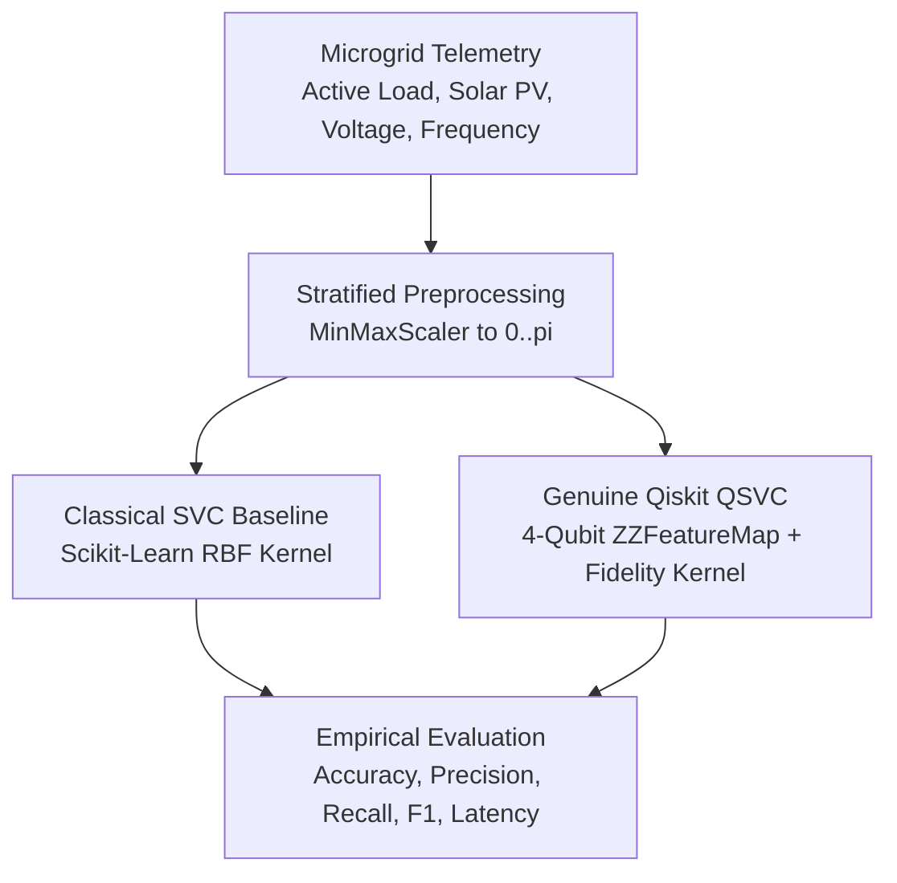

<div align="center">

# Q-Resilience AI (Ctrl_AI)

**VTU-QFF-HC-0025** &nbsp;|&nbsp; Tier: **Both**

An Autonomous Dual-Model Quantum vs Classical Microgrid Anomaly Detection Platform built for the **VTU-Qiskit Fall Fest 2026 Hackathon**.

[](https://qresilience.vercel.app)
[](https://q-silience.onrender.com/health)
[](https://youtu.be/HAgrzv3rs3k)
[](https://github.com/Dhyanpol55/Q-Silience)

</div>

---

<div align="center">

| | |
| :--- | :--- |
| **Team** | Ctrl_AI |
| **Team ID** | VTU-QFF-HC-0025 |
| **Tier** | Both |
| **Primary Repo** | [Dhyanpol55/Q-Silience](https://github.com/Dhyanpol55/Q-Silience) |
| **Hackathon Repo** | [vtu-hc-ctrl-ai](https://github.com/vtu-qiskit-fall-fest-2026/vtu-hc-ctrl-ai.git) |
| **Organisation** | [vtu-qiskit-fall-fest-2026](https://github.com/vtu-qiskit-fall-fest-2026) |
| **Event** | VTU-QFF Hackathon — VTU-Qiskit Fall Fest 2026 |

</div>

---

## 📌 Table of Contents

- [Live Deployments & Demo](#-live-deployments--demo)
- [Problem Statement](#-problem-statement)
- [Proposed Solution](#-proposed-solution)
- [Approach & Architecture](#-approach--architecture)
- [Empirical Benchmark & Measured Results](#-empirical-benchmark--measured-results)
- [Scientific Disclosures & Integrity](#-scientific-disclosures--integrity)
- [Tech Stack](#-tech-stack)
- [Project Structure](#-project-structure)
- [How to Run](#-how-to-run)
- [Submission Checklist](#-submission-checklist)
- [License](#-license)

---

## 🌐 Live Deployments & Demo

- **Live Production App (Vercel)**: [https://qresilience.vercel.app](https://qresilience.vercel.app)
- **Live Backend API (Render)**: [https://q-silience.onrender.com](https://q-silience.onrender.com)
  - Health & Version Status: [`https://q-silience.onrender.com/health`](https://q-silience.onrender.com/health)
  - Empirical Benchmark Endpoint: [`https://q-silience.onrender.com/api/benchmark`](https://q-silience.onrender.com/api/benchmark)
  - Interactive API Docs (Swagger): [`https://q-silience.onrender.com/docs`](https://q-silience.onrender.com/docs)
- **Video Walkthrough**: [https://youtu.be/HAgrzv3rs3k](https://youtu.be/HAgrzv3rs3k)

---

## ❓ Problem Statement

**Problem:** Modern smart microgrids operating with high penetration of inverter-based distributed energy resources (DERs) suffer from ultra-low physical inertia. Transients such as cloud-induced solar ramps, abrupt load surges, and network faults produce non-linear, multi-sensor anomalies that conventional rule-based protection often misses.

**Why it matters:** As electrical grids decarbonize, detecting non-linear voltage and frequency deviations before islanding or tripping occurs is vital for power system resilience. Assessing whether a dual-model quantum-classical framework can outperform a classical-only baseline under constrained data regimes is central to operational trust and safe control.

**Track / Category:** Both (Online / Offline Track) · Clean Energy & Smart Power Systems · Quantum Machine Learning

---

## 💡 Proposed Solution

**Solution:** Q-Resilience AI provides an end-to-end, dual-model microgrid anomaly detection platform. It evaluates synthetic multi-bus telemetry against an IEEE 1547.4 physics model and performs a side-by-side comparison between a classical SVC and a genuine Qiskit QSVC.

**Key idea:** Non-linear sensor telemetry $[P_d, P_{pv}, \Delta V, \Delta f]$ is min-max scaled into $[0, \pi]$ and encoded into quantum state amplitudes via parameterized single-qubit rotations and entangling two-qubit phases.

**Why this works:** The platform offers side-by-side transparency: operators can observe real-time telemetry streaming, simulate operational stress scenarios, inspect the exact parameterized quantum circuit, and compare classical vs quantum decision boundaries under identical conditions.

---

## 🧩 Approach & Architecture



1. **Input**: 4 physical telemetry streams normalized to $[0, \pi]$ (active load $P_d$, PV generation $P_{pv}$, voltage deviation $\Delta V$, and frequency deviation $\Delta f$).
2. **Preprocessing**: Stratified 75% train (45 samples), 25% test (15 samples) with seed `42` and zero data leakage.
3. **Quantum Core**: Qiskit `ZZFeatureMap` (4 qubits, reps=2, linear entanglement) paired with `FidelityQuantumKernel` executing via Qiskit 1.4.6 and Qiskit Machine Learning 0.8.2.
4. **Evaluation**: Both models are benchmarked for accuracy, precision, recall, F1-score, and latency using the same held-out microgrid dataset.
5. **Output**: Actionable anomaly detection scorecards with operator-facing telemetry plots and scenario diagnostics.

---

## 📊 Empirical Benchmark & Measured Results

The synthetic benchmark uses 60 observations (45 train, 15 test) with a clean stratified split and no leakage. We compare a classical RBF SVC against a genuine Qiskit QSVC under identical conditions.

| Metric | Classical Baseline (Scikit-Learn SVC) | Genuine Quantum Model (Qiskit ML QSVC) |
| :--- | :--- | :--- |
| **Test Accuracy** | **100.0%** | **86.7%** |
| **Precision** | **1.000** | **0.857** |
| **Recall** | **1.000** | **0.857** |
| **F1-Score** | **1.000** | **0.857** |
| **Training Time** | **3.1 ms** | **27,012.02 ms** |
| **Inference Time** | **0.35 ms** | **17,393.71 ms** |

### Confusion Matrix (Held-Out Test Set)
- **Classical SVC**: `[[8, 0], [0, 7]]`
- **Genuine QSVC**: `[[7, 1], [1, 6]]`

> **Scientific Disclosure**: In this synthetic benchmark, the classical baseline retains both the accuracy and performance advantage, while quantum execution remains materially slower because statevector simulation scales exponentially with qubit count.

---

## 🧪 Scientific Disclosures & Integrity

- The benchmark is on a synthetic microgrid telemetry dataset, not field-deployed operational data.
- We make no claim of quantum advantage on this dataset.
- The quantum model is evaluated by statevector simulation, which approximates real hardware execution but does not imply a deployment-ready advantage.
- Validation is kept transparent with fixed seeds, deterministic train/test splits, and explicit model comparisons.

---

## 🛠️ Tech Stack

| Layer | Technology |
| :--- | :--- |
| Frontend | React 19 + Vite + TypeScript + Tailwind CSS |
| Backend | FastAPI + Uvicorn |
| Classical ML | scikit-learn SVC |
| Quantum ML | Qiskit + Qiskit Machine Learning |
| Data | pandas, NumPy, joblib |
| Deployment | Vercel + Render |

---

## 📁 Project Structure

```text
Q-Resilience-AI/
├── frontend/
│   ├── src/
│   ├── public/
│   ├── package.json
│   └── vite.config.ts
├── backend/
│   ├── app/
│   ├── tests/
│   ├── main.py
│   └── requirements.txt
├── q-resilience-ai/
│   ├── src/
│   ├── tests/
│   └── README.md
├── README.md
├── requirements.txt
├── package.json
├── docker-compose.yml
└── LICENSE
```

---

## 🚀 How to Run

### Frontend
```bash
cd frontend
npm install
npm run dev
```

### Backend
```bash
cd backend
python3 -m venv .venv
source .venv/bin/activate
pip install -r requirements.txt
python -m uvicorn main:app --reload --port 8000
```

---

## ✅ Submission Checklist

- [x] Problem statement defined and contextualized
- [x] Quantum-classical anomaly detection workflow built
- [x] Frontend & backend integrated
- [x] Benchmark results collected and documented
- [x] Live deployment links included
- [x] Repository references for hackathon submission prepared

---

## 📄 License

This project is licensed under the MIT License.

