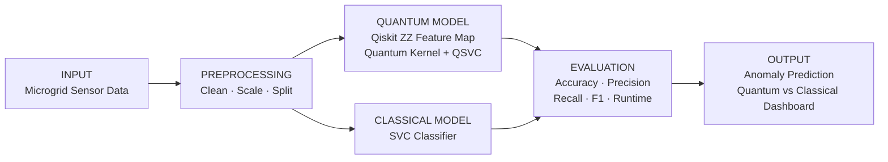

<div align="center">

# Ctrl_AI

**VTU-QFF-HC-0025** &nbsp;|&nbsp; Tier: **Both**

</div>

---

<div align="center">

| | |
| :--- | :--- |
| **Team** | Ctrl_AI |
| **Team ID** | VTU-QFF-HC-0025 |
| **Tier** | Both |
| **Repository** | [vtu-hc-ctrl-ai](https://github.com/vtu-qiskit-fall-fest-2026/vtu-hc-ctrl-ai.git) |
| **Organisation** | [vtu-qiskit-fall-fest-2026](https://github.com/vtu-qiskit-fall-fest-2026) |
| **Event** | VTU-QFF Hackathon — VTU-Qiskit Fall Fest 2026 |

</div>

---

## 📌 Table of Contents

- [Team Members](#-team-members-github-ids)
- [Problem Statement](#-problem-statement)
- [Proposed Solution](#-proposed-solution)
- [Approach & Architecture](#-approach--architecture)
- [Tech Stack](#-tech-stack)
- [Project Structure](#-project-structure)
- [How to Run](#-how-to-run)
- [How to Push Code](#-how-to-push-code)
- [Submission Checklist](#-submission-checklist)
- [Resources](#-resources)
- [License](#-license)

---

## 👥 Team Members (GitHub IDs)

| # | Name | GitHub Username | Role |
| :-- | :--- | :--- | :--- |
| 1 | Dhyan P | Dhyanpol55 | Team Lead |
| 2 | Sangamesh Athani | SangameshAthani | Developer |
| 3 | Harsha Hiregoudar | harshhgouda-byte | Developer |

---

## ❓ Problem Statement

**Problem:** Microgrids depend on sensor data to monitor electricity demand, solar generation, battery charge, voltage, and frequency. Abnormal readings may indicate power-quality issues or unusual grid events. Early detection is critical for maintaining system stability and reducing the risk of outages.

**Why it matters:** Detecting abnormal conditions early helps operators investigate potential problems, improve monitoring, and support more reliable microgrid operation. Machine learning can identify anomalies before they escalate into service disruption.

**Track / Category:** Online · Quantum + AI & ML

---

## 💡 Proposed Solution

**Solution:** Q-Silience is a microgrid anomaly-detection prototype that analyzes sensor data and classifies operating conditions as normal or anomalous. It compares a Qiskit-based Quantum Kernel approach with a classical machine-learning baseline.

**Key idea:** Apply quantum-kernel machine learning to microgrid sensor data and compare its performance against a classical machine-learning baseline.

**Why this works:** The prototype evaluates both approaches using metrics such as accuracy, precision, recall, F1-score, and confusion matrices.

---

## 🧩 Approach & Architecture



1. **Input** — Microgrid sensor readings such as demand, solar generation, battery level, voltage, and frequency.
2. **Preprocessing** — Clean the dataset, normalize features, and split into training and testing sets.
3. **Quantum model** — Use a Qiskit-based ZZ feature map with a quantum kernel and QSVC.
4. **Classical model** — Train a conventional SVC as the baseline using the same data.
5. **Evaluation** — Compare both models using accuracy, precision, recall, F1 score, and runtime.
6. **Output** — Generate anomaly predictions and side-by-side benchmark results.

---

## 🛠️ Tech Stack

| Layer | Technology |
| :--- | :--- |
| Language | Python 3.11+ |
| Quantum SDK | Qiskit `>=1.0`, Qiskit Aer |
| ML | scikit-learn |
| Data | NumPy, Pandas |
| API | FastAPI |
| Frontend | React + TypeScript + Vite |
| Version control | Git + GitHub |

---

## 📁 Project Structure

```text
vtu-hc-ctrl-ai/
├── README.md
├── requirements.txt
├── pyproject.toml
├── .gitignore
├── backend/
│   ├── main.py
│   ├── requirements.txt
│   ├── render.yaml
│   └── tests/
│       └── test_api.py
├── q-resilience-ai/
│   ├── README.md
│   ├── requirements.txt
│   └── src/
│       ├── __init__.py
│       ├── classical_model.py
│       ├── data_generator.py
│       ├── evaluation.py
│       ├── preprocessing.py
│       ├── quantum_model.py
│       ├── scenario_engine.py
│       └── visualizations.py
├── src/
│   ├── App.tsx
│   ├── index.css
│   ├── main.tsx
│   └── services/
├── tests/
│   └── ...
├── docs/
│   ├── architecture.md
│   ├── benchmark_report.md
│   └── quantum_mechanics.md
└── data/
    └── microgrid_telemetry.csv
```

---

## 🚀 How to Run

### 1. Create a virtual environment

```bash
python3 -m venv .venv
source .venv/bin/activate
```

### 2. Install dependencies

```bash
pip install -r requirements.txt
```

### 3. Run the backend

```bash
uvicorn backend.main:app --host 0.0.0.0 --port 8000
```

### 4. Run tests

```bash
pytest -q
```

---

## 🔁 How to Push Code

```bash
git checkout -b feature/q-resilience-ai
git add .
git commit -m "Add Q-Resilience AI project"
git push origin feature/q-resilience-ai
```

---

## ✅ Submission Checklist

- [x] Problem statement defined
- [x] Solution and architecture documented
- [x] Quantum and classical models implemented
- [x] Benchmark metrics available
- [x] Project structure prepared for submission

---

## 📚 Resources

- [Qiskit Documentation](https://qiskit.org/documentation/)
- [scikit-learn Documentation](https://scikit-learn.org/stable/)
- [FastAPI Documentation](https://fastapi.tiangolo.com/)

---

## 📄 License

This project is licensed under the MIT License.
