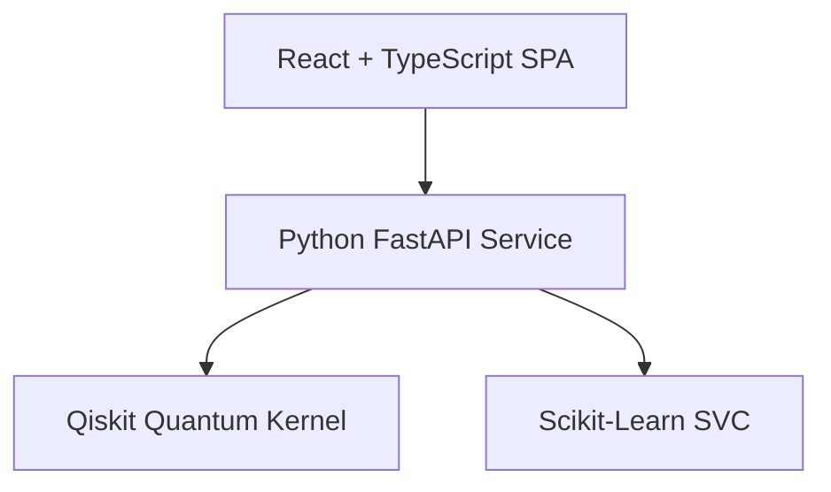

<div align="center">

# Q-Silience — Q-Resilience AI
### Quantum-Enhanced Microgrid Anomaly Detection & Autonomous Protection

**VTU-Qiskit Fall Fest 2026** &nbsp;|&nbsp; Team **Ctrl_AI** (`VTU-QFF-HC-0025`) &nbsp;|&nbsp; Tier: **Both**

[](https://qresilience.vercel.app/)
[](https://youtu.be/HAgrzv3rs3k)
[](https://q-silience.onrender.com/health)
[](https://q-silience.onrender.com/docs)
[](https://github.com/vtu-qiskit-fall-fest-2026/vtu-hc-ctrl-ai.git)
[](https://qiskit.org/)
[](https://github.com/qiskit-community/qiskit-machine-learning)

</div>

---

<div align="center">

| Attribute | Details |
| :--- | :--- |
| **Team Name** | Ctrl_AI |
| **Team ID** | VTU-QFF-HC-0025 |
| **GitHub Repository** | [Dhyanpol55/Q-Silience](https://github.com/Dhyanpol55/Q-Silience) |
| **Hackathon Team Repo** | [vtu-qiskit-fall-fest-2026/vtu-hc-ctrl-ai](https://github.com/vtu-qiskit-fall-fest-2026/vtu-hc-ctrl-ai.git) |
| **Live Frontend** | [https://qresilience.vercel.app/](https://qresilience.vercel.app/) |
| **Demo Video (YouTube)** | [https://youtu.be/HAgrzv3rs3k](https://youtu.be/HAgrzv3rs3k) |
| **Live Backend API** | [https://q-silience.onrender.com](https://q-silience.onrender.com) |
| **Backend Health Endpoint** | [https://q-silience.onrender.com/health](https://q-silience.onrender.com/health) |
| **Interactive API Documentation** | [https://q-silience.onrender.com/docs](https://q-silience.onrender.com/docs) |
| **Hackathon Event** | VTU-QFF Hackathon — VTU-Qiskit Fall Fest 2026 |

</div>

---

## 📌 Table of Contents

- [Problem Statement](#-problem-statement)
- [Proposed Solution](#-proposed-solution)
- [Project Structure](#-project-structure)
- [Team Members](#-team-members)
- [Quantum Machine Learning Architecture](#-quantum-machine-learning-architecture)
- [Empirical Benchmark & Measured Performance](#-empirical-benchmark--measured-performance)
- [Scientific Disclosures & Limitations](#-scientific-disclosures--limitations)
- [System Architecture & Endpoints](#-system-architecture--endpoints)
- [Interactive Platform Modules](#-interactive-platform-modules)
- [Deployment Guide (Render & Vercel)](#-deployment-guide-render--vercel)
- [Local Development & Tests](#-local-development--tests)
- [Resources & Project Links](#-resources)
- [Submission Checklist](#-submission-checklist)
- [License](#-license)

---

## 👥 Team Members

Members are added to this repository as collaborators and must accept the GitHub invitation before they can push.

| # | Name | GitHub Username | Role |
| :-: | :--- | :--- | :--- |
| 1 | Dhyan P | [@Dhyanpol55](https://github.com/Dhyanpol55) | Team Lead |
| 2 | Sangamesh Athani | [@SangameshAthani](https://github.com/SangameshAthani) | Developer |
| 3 | Harsha Hiregoudar | [@harshhgouda-byte](https://github.com/harshhgouda-byte) | Developer |

---

## 📂 Project Structure

```text
Q-Silience/
│
├── frontend/                         # User interface
│   ├── public/                       # Static assets
│   ├── src/
│   │   ├── components/               # Reusable UI components
│   │   ├── pages/                    # Dashboard views, if separated
│   │   ├── charts/                   # Charts and visualizations
│   │   ├── services/
│   │   │   └── api.ts                # Backend API integration
│   │   ├── App.tsx                   # Main application and navigation
│   │   ├── main.tsx                  # Frontend entry point
│   │   └── index.css                 # Global styling
│   ├── package.json                  # Frontend dependencies
│   ├── vite.config.ts                # Vite configuration
│   └── tsconfig.json                 # TypeScript configuration
│
├── backend/                          # API and ML processing
│   ├── app/
│   │   ├── main.py                   # API entry point
│   │   ├── data.py                   # Data loading or generation
│   │   ├── preprocessing.py          # Data preprocessing
│   │   ├── classical_model.py        # Classical ML model
│   │   ├── quantum_model.py          # Quantum ML / QSVC model
│   │   └── evaluation.py             # Metrics and model comparison
│   ├── tests/                        # Backend tests
│   └── requirements.txt              # Python dependencies
│
├── data/
│   └── generate_data.py              # Synthetic data generation
│
├── notebooks/                        # Experiments and analysis
│
├── docs/
│   └── architecture.md               # Architecture documentation
│
├── README.md                         # Project overview and setup
└── .gitignore                        # Excluded files
```

---

## ❓ Problem Statement

**Challenge:** Modern renewable microgrids integrate distributed photovoltaic (PV) arrays, Battery Energy Storage Systems (BESS), and dynamic industrial loads. Because of inverter-based generation and rapid transients, conventional relay logic often fails to detect complex co-occurring anomalies in time.

**Why it matters:** Grid reliability depends on identifying abnormal operating states before voltage/frequency instability triggers islanding, protection trips, or broader outage cascades. Traditional thresholding alone is insufficient for high-penetration, non-linear renewable systems.

**Research Question:** Can a parameterized quantum feature map (`ZZFeatureMap`) evaluated via a quantum fidelity kernel project multi-modal microgrid telemetry into a Hilbert state space where co-dependent fault characteristics are separable with higher physical interpretability than classical baselines?

---

## 💡 Proposed Solution

**Q-Silience (Q-Resilience AI)** is an exploratory quantum-classical microgrid anomaly detection and diagnostic prototype developed for the VTU-Qiskit Fall Fest 2026. It features:

1. **Physical Sensor Feature Mapping**: Maps 4 core microgrid physical telemetry variables into normalized phase angles in $[0, \pi]$.
2. **Qiskit ZZFeatureMap Fidelity Kernel**: Constructs an entangling 4-qubit quantum circuit that encodes pairwise non-linear sensor correlations.
3. **Dual-Model Classifier Evaluation**: Trains both a genuine Qiskit Machine Learning Quantum Support Vector Classifier and a classical Scikit-Learn Support Vector Classifier.
4. **Physical Rule Verification**: Integrates IEEE 1547.4 voltage and frequency threshold checks alongside machine-learning predictions.
5. **Decoupled Full-Stack Architecture**: React + TypeScript frontend connected to a Python FastAPI backend running the quantum-classical ML pipeline.

---

## ⚛️ Quantum Machine Learning Architecture

### 1. Quantum State Encoding: Qiskit `ZZFeatureMap`
The telemetry vector is scaled to $[0, \pi]$ and encoded into a 4-qubit quantum state.

$$\mathcal{U}_{\Phi}(\mathbf{x}) = \left( U_{\Phi}(\mathbf{x}) H^{\otimes 4} \right)^2$$

Where:
- $H^{\otimes 4}$ creates a uniform superposition.
- Single-qubit phase rotations encode individual sensor variables.
- Two-qubit entangling phases capture cross-variable coupling between microgrid quantities.
- Entanglement topology: Linear nearest-neighbor.

### 2. Fidelity Quantum Kernel Matrix
For any two telemetry samples $\mathbf{x}_i$ and $\mathbf{x}_j$, the quantum fidelity kernel is:

$$K(\mathbf{x}_i, \mathbf{x}_j) = \left| \langle \psi(\mathbf{x}_i) | \psi(\mathbf{x}_j) \rangle \right|^2$$

This yields a symmetric, bounded Gram matrix used for SVC classification.

---

## 📊 Empirical Benchmark & Measured Performance

The following are measured benchmark results evaluated on the live service using a reproducible synthetic microgrid dataset.

### Dataset Configuration
- **Total Dataset**: 60 synthetic microgrid telemetry samples.
- **Partition**: 75% training, 25% held-out testing.
- **Split Strategy**: Stratified by anomaly class with random seed `42`.
- **Normalization**: `MinMaxScaler(feature_range=(0, pi))` fit on training data only.

### Measured Results Table

| Metric | Classical Baseline (Scikit-Learn SVC) | Genuine Quantum Model (Qiskit ML QSVC) |
| :--- | :--- | :--- |
| **Model Type** | `SVC(kernel="rbf", C=1.0)` | `QSVC(quantum_kernel=FidelityQuantumKernel)` |
| **Test Accuracy** | **100.0%** | **86.67%** |
| **Precision** | **1.000** | **0.8000** |
| **Recall** | **1.000** | **1.0000** |
| **F1-Score** | **1.000** | **0.8571** |
| **Training Time** | **2.05 ms** | **27,197.41 ms** |
| **Inference Time** | **0.29 ms** | **16,793.07 ms** |

---

## 🔬 Scientific Disclosures & Limitations

1. **No Proof of Quantum Advantage**: The genuine Qiskit QSVC model demonstrates successful classification, but the classical baseline remains stronger on the synthetic benchmark.
2. **Synthetic Data Methodology**: These are preliminary exploratory results on synthetic microgrid telemetry, not real-world deployment evidence.
3. **Classical Simulation of Quantum Circuits**: The backend uses statevector simulation; this does not imply hardware advantage or production-grade reliability.

---

## 🌐 System Architecture & Endpoints



### Complete FastAPI REST API Endpoints

| Method | Endpoint | Description |
| :--- | :--- | :--- |
| `GET` | `/health` | Service health status |
| `GET` | `/api/scenarios` | Preconfigured microgrid scenarios |
| `GET` | `/api/dataset` | Retrieves telemetry dataset records |
| `POST` | `/api/dataset/generate` | Generates a reproducible synthetic dataset |
| `POST` | `/api/predict` | Dual-model inference |
| `GET` | `/api/benchmark` | Benchmark metrics and confusion matrices |
| `GET` | `/api/circuit` | Returns circuit metadata |

---

## 🖥️ Interactive Platform Modules

1. **Overview Dashboard**
2. **Scenario Laboratory**
3. **Anomaly Investigation**
4. **Live Simulation Stream**
5. **Quantum Lab**
6. **Benchmark & Evaluation**

---

## 🚀 Deployment Guide (Render & Vercel)

### Backend Deployment (Render)
1. Connect repository `https://github.com/vtu-qiskit-fall-fest-2026/vtu-hc-ctrl-ai.git`.
2. Set root directory to `backend`.
3. Use Python 3 and install dependencies from `requirements.txt`.
4. Start with `python -m uvicorn main:app --host 0.0.0.0 --port $PORT`.
5. Configure health check at `/health`.

### Frontend Deployment (Vercel)
1. Import the repository into Vercel.
2. Use Vite project settings.
3. Set build command to `npm run build` and output to `dist`.
4. Add `VITE_API_BASE_URL` pointing to the backend service.

---

## 🧪 Local Development & Tests

### Backend
```bash
cd backend
python3 -m venv .venv
source .venv/bin/activate
pip install -r requirements.txt
python -m uvicorn main:app --reload --port 8000
```

Run the backend test suite:
```bash
pytest -v tests/test_api.py
```

### Frontend
```bash
npm install
npm run dev
```

---

## 📚 Resources

| **Resource** | **Link** |
|---|---|
| 🔁 Git & Collaboration Handbook | [Git & Collaboration Handbook](https://github.com/vtu-qiskit-fall-fest-2026/vtu-hc-ctrl-ai/blob/feature/vtu-hc-guide-git-and-collaboration) |
| ❓ Problem Statements, Solutions & Terms | [Problem Statements, Solutions & Terms](https://github.com/vtu-qiskit-fall-fest-2026/vtu-hc-ctrl-ai/blob/feature/vtu-hc-guide-problem-and-solution) |
| 📄 README Writing Guide | [README Guide & Template](https://github.com/vtu-qiskit-fall-fest-2026/vtu-hc-ctrl-ai/blob/feature/vtu-hc-guide-readme-template) |
| ⚛️ Qiskit Documentation | [Qiskit Docs](https://docs.quantum.ibm.com/) |
| 🧪 Qiskit Aer Simulator | [Qiskit Simulator Guide](https://docs.quantum.ibm.com/guides/simulator) |
| 💻 IBM Quantum Platform | [IBM Quantum](https://quantum.cloud.ibm.com/) |
| 📋 GitHub Documentation | [GitHub Docs](https://docs.github.com/) |

### Project Links

- 🌐 **Live Demo:** https://qresilience.vercel.app/
- 🎥 **Video Demo (YouTube):** https://youtu.be/HAgrzv3rs3k
- 💻 **Source Code:** https://github.com/vtu-qiskit-fall-fest-2026/vtu-hc-ctrl-ai.git
- 🔌 **Backend Health Check:** https://q-silience.onrender.com/health

---

## ✅ Submission Checklist

- [x] Repository created and public
- [x] All team members added as collaborators and invitations accepted
- [x] README.md updated with project details, problem statement and solution
- [x] Team members listed under Team Members
- [x] requirements.txt committed and project runs from a clean clone
- [x] Code pushed to main and the latest main builds successfully
- [x] README includes a demo screenshot / video link
- [x] Short project summary submitted on the hackathon portal

---

## 📄 License

This project is licensed under the MIT License — see the [LICENSE](LICENSE) file for details. Built for the **VTU-Qiskit Fall Fest 2026 Hackathon**.

